<p align="center">
  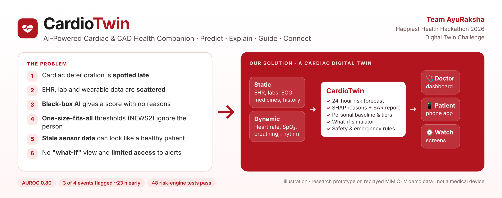
</p>

<p align="center">
  <b>Team AyuRaksha</b> · Happiest Health Hackathon 2026 · Digital Twin Challenge<br>
  <sub>Research prototype · not a medical device · built on open, de-identified MIMIC-IV demo data</sub>
</p>

<p align="center">
   <a href="assets/architecture/cardiotwin_system_architecture.pdf"><b>System Architecture</b></a> &nbsp;&nbsp;|&nbsp;&nbsp;
   <a href="assets/presentation/CardioTwin_AyuRaksha_Presentation.pdf"><b>Presentation</b></a> &nbsp;&nbsp;|&nbsp;&nbsp;
   <a href="#c-demo-video"><b>Demo Video</b></a> &nbsp;&nbsp;|&nbsp;&nbsp;
   <a href="#team-ayuraksha"><b>Team</b></a>
</p>

<p align="center">
  &nbsp;&nbsp;&nbsp;&nbsp;&nbsp;&nbsp;&nbsp;&nbsp;&nbsp;&nbsp;&nbsp;&nbsp;&nbsp;&nbsp;&nbsp;&nbsp;&nbsp;&nbsp;&nbsp;&nbsp;&nbsp;&nbsp;&nbsp;&nbsp;
</p>

---

## Team AyuRaksha

**College:** Sri Shankaracharya Technical Campus

| Member | Role |
|---|---|
| **Tanya Jain** | Team Leader · Full backend development and data collection |
| **Praveen Yadav** | AI and ML pipeline |
| **Mohammad Danishuddin** | Connectivity of all three systems (doctor dashboard, patient app, watch) |
| **Ankur Pandey** | UI and presentation |

---

**Status labels used in this README:** 🟢 **Implemented** (in the code and shown in the prototype) · 🟡 **Proposed** (designed or coded, not yet verified) · 🔵 **Future Scope** (planned)

## Contents

1. [The problem](#1-the-problem)
2. [Our solution](#2-our-solution)
3. [Three dashboards, one twin](#3-three-dashboards-one-twin)
4. [Key features](#4-key-features)
5. [What makes CardioTwin unique](#5-what-makes-cardiotwin-unique)
6. [Our unique vision: a watch-connected digital twin](#6-our-unique-vision-a-watch-connected-digital-twin)
7. [Healthcare use case](#7-healthcare-use-case)
8. [Architecture and AI/ML](#8-architecture-and-aiml)
9. [Technical stack](#9-technical-stack)
10. **[Submission files](#10-submission-files)**
    - a. [System Architecture](#a-system-architecture)
    - b. [Presentation](#b-presentation)
    - c. [Demo Video](#c-demo-video)
11. [Run it locally](#11-run-it-locally)
12. [Responsible AI and limitations](#12-responsible-ai-and-limitations)
13. [License](#13-license)

---

## 1. The problem

> **Problem statement:** To address the lack of early cardiac risk awareness, explainable predictions, personalized health guidance, and accessible emergency support.
>
> **Theme:** MedTech / BioTech / HealthTech · **Category:** Software

<p align="center">
  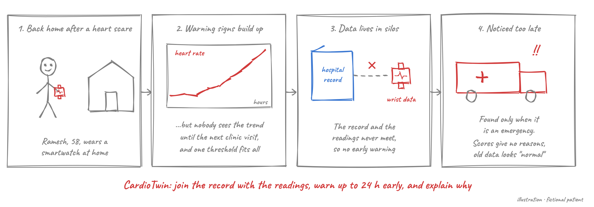
</p>

Cardiac deterioration usually shows up in the vital signs hours before a crisis, but those signals are hard to act on:

- **Scattered data.** The health record (age, diagnoses, labs, medicines) and the live vitals (heart rate, SpO₂, breathing) sit in separate systems.
- **Generic thresholds.** Early-warning scores such as NEWS2 apply the same cut-offs to everyone. In our data NEWS2 scored an AUPRC of just 0.074.
- **Black-box AI.** A risk number without reasons is hard for a doctor to trust.
- **Stale data.** A silent sensor can look like a healthy patient.
- **No "what-if" and little access.** Doctors cannot test scenarios, and patients have limited access to alerts once they leave the hospital.

CardioTwin brings **history and live physiology together** in one place. It **looks ahead**, and it **explains** the result to doctors and to patients.

## 2. Our solution

**CardioTwin is a cardiac digital twin.** It builds a per-patient virtual model from two data streams, forecasts acute deterioration 24 hours ahead and explains why. It shows the result to the doctor, the patient and a watch screen.

| | What it does in the prototype | |
|---|---|---|
| **Fuse** | Joins the static EHR (demographics, diagnoses, labs, ECG, medicines) with dynamic vitals (heart rate, SpO₂, breathing rate, BP, rhythm) | 🟢 |
| **Predict** | Estimates the risk of vasopressor start, lactate ≥ 4 or in-hospital death within the next 24 hours, re-scored every hour | 🟢 |
| **Explain** | Gives the top SHAP reasons and a doctor-ready SAR report (Situation, Assessment, Recommendation) | 🟢 |
| **Simulate** | The what-if simulator shows how risk moves if a vital sign or risk factor changes | 🟢 |
| **Protect** | Freshness gates, emergency rules that run before the model, and a 112 prompt only for critical patients (the user presses Call) | 🟢 |
| **Deliver** | One backend serves the doctor dashboard, the patient app and the watch screens | 🟢 |

**How data flows:** PhysioNet data → clean and merge → 211 engineered features → train and calibrate → saved model. Live readings (replayed by a *virtual watch*) → validate → safety rules → risk engine → SHAP and SAR → dashboards over WebSocket.

## 3. Three dashboards, one twin

<p align="center">
  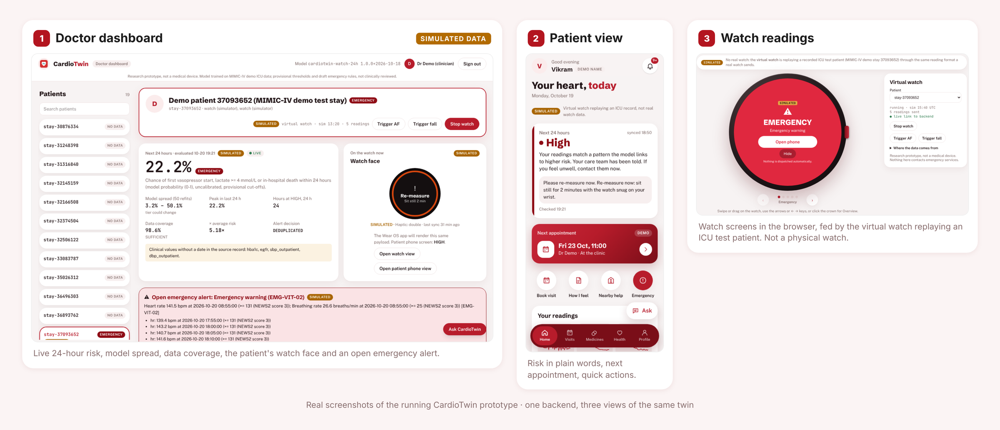
</p>

<p align="center"><sub>Real screenshots of the running prototype. The data is a replayed MIMIC-IV ICU test patient, labelled <b>SIMULATED</b> on screen.</sub></p>

<details>
<summary><b>See each screen full size</b></summary>

**Doctor dashboard:** live risk, model spread, data coverage, watch face and alerts
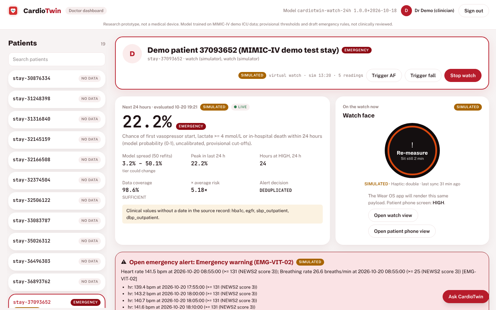

**Patient view:** home, medicines and nearby help
<p>
  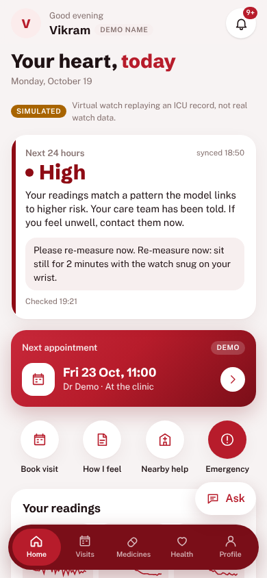
  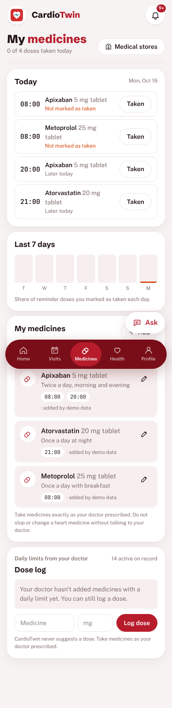
  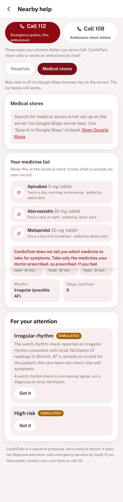
</p>

**Watch readings:** watch screens in the browser, driven by the virtual watch (not a physical watch)
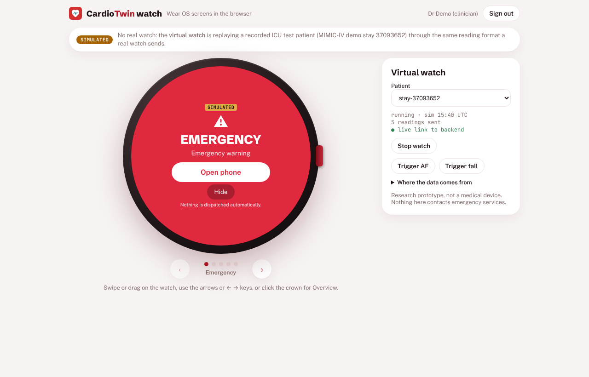

</details>

## 4. Key features

| Feature | Status |
|---|:---:|
| **Data pipeline:** four PhysioNet sources become linked, cleaned CSVs (notebooks 01–02) | 🟢 |
| **Two AI models:** a full model (EHR + vitals, LightGBM) and a watch-only model (logistic regression) | 🟢 |
| **Risk tiers:** LOW (within baseline) · MODERATE (≥ 3.62%) · HIGH (≥ 7.59%), with hysteresis | 🟢 |
| **Explainable AI:** SHAP reasons, waterfalls and SAR doctor reports | 🟢 |
| **Risk engine:** a 10-step pipeline. 48 tests pass, and it gives the same tier as the trained model for 99.7% of test hours | 🟢 |
| **What-if simulator:** 21 levers, sensitivity curves and counterfactuals, labelled HYPOTHETICAL | 🟢 |
| **Safety layer:** 30 s fall check, confirmed-AF review, QTc ≥ 500 ms review, dose check, NEWS2 red bands | 🟢 |
| **Doctor dashboard · patient app · watch screens** (React) | 🟢 |
| **Virtual watch:** replays 19 held-out ICU stays, labelled SIMULATED | 🟢 |
| **Ask CardioTwin chatbot:** heart and CAD education, with emergency phrases in English, Hindi and Hinglish | 🟢 offline mode · 🟡 AI mode |
| **Heart-health (CAD) view and wellness coach:** risk factors, Indian meal ideas, activity goals | 🟢 |
| **Nearby hospitals and pharmacies** (Google Places) | 🟡 |
| **Ambulance tracking:** a labelled demo only, so nobody is dispatched | 🟢 demo · 🔵 real dispatch |
| **Wear OS watch app** (Kotlin, source code only, never built) | 🟡 |

## 5. What makes CardioTwin unique

- **A living twin, not a one-off score.** Each patient's state updates as readings arrive, and you can ask it "what if".
- **A watch-ready AI model.** A second model uses only watch-like signals. It flags the same 3 of 4 events as the full model.
- **Explanation first.** Every score comes with reasons, a SAR report and plain words for the patient.
- **Safety by design.** It returns `INSUFFICIENT_DATA` instead of a guess, emergency rules run before the model, and nothing is dispatched automatically.
- **Honest labels.** Simulated data, demo ambulances and offline answers are all marked on screen.
- **One backend, three views.** The doctor, the patient and the watch all read the same twin.

<table>
  <tr>
    <td align="center" width="28%">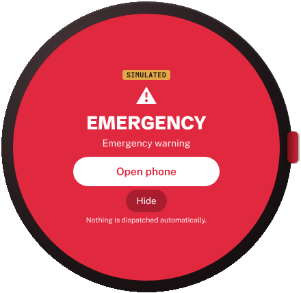</td>
    <td align="center" width="36%">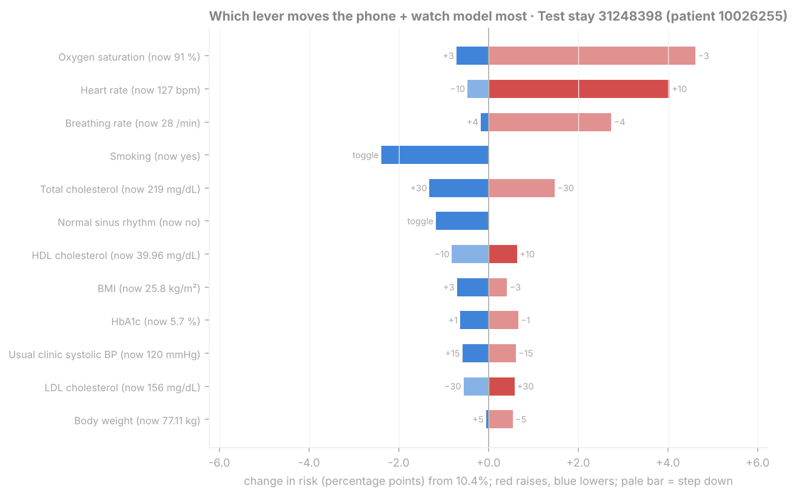</td>
    <td align="center" width="36%">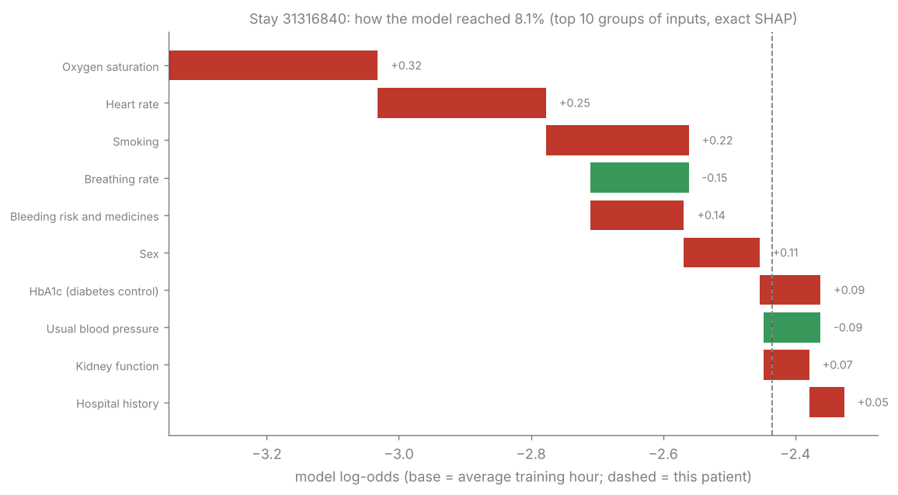</td>
  </tr>
  <tr>
    <td align="center"><b>Watch view</b><br>The twin's state as one glanceable watch screen (browser rendering, simulated data)</td>
    <td align="center"><b>What-if simulator</b><br>Which change would move this patient's risk the most</td>
    <td align="center"><b>SHAP explanation</b><br>Why the model gave this patient 8.1%, factor by factor</td>
  </tr>
</table>

## 6. Our unique vision: a watch-connected digital twin

> 🔵 **Future Scope.** Today CardioTwin does **not** connect to a physical smartwatch, receive live wearable data, monitor continuously or send real medical alerts.

The goal is a twin that stays current **between clinic visits**. A compatible smartwatch would send the signals it really supports, the backend would keep the person's twin up to date, and the doctor and the patient would see the same explained picture.

<p align="center">
  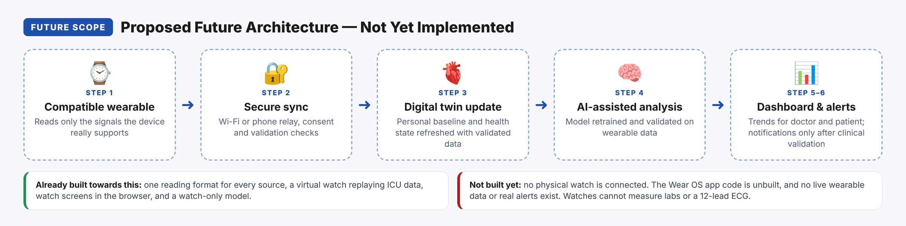
</p>

<p align="center"><sub>Conceptual diagram, not a screenshot: <b>Proposed Future Architecture — Not Yet Implemented</b>.</sub></p>

| Building block | Status |
|---|:---:|
| One reading format for every source, so a real watch would use the same endpoint | 🟢 |
| Virtual watch replaying ICU vitals (HRV, steps, sleep and QTc are synthetic) | 🟢 |
| Watch screens in the browser | 🟢 |
| Watch-only model, trained on ICU monitor signals and not yet validated on wrist data | 🟢 |
| Wear OS app with Health Services, fall heuristic and QR pairing: code exists, never built or run | 🟡 |
| Real watch sync, live monitoring, validated notifications | 🔵 |

**Envisioned steps (Future Scope):** 1) collect supported signals from a compatible wearable → 2) sync securely over Wi-Fi or through the phone → 3) update the twin with validated data → 4) analyse with a model validated on wearable data → 5) show trends on the dashboard and watch → 6) send notifications only after clinical validation.

**A watch cannot do everything.** Labs, lactate, a diagnostic 12-lead ECG and medication records still come from clinical systems, which is why the EHR stays half of the twin. Which signals are available depends on the device. SpO₂ and ECG usually need vendor SDKs (for example the Samsung Health Sensor SDK), so device support is a requirement for the future work.

**Before this is real:** build and test the Wear OS app on an emulator and then on real devices. Retrain and validate on consented wearable data, validate fall detection, and get clinical review of all rules. Add production security that complies with the DPDP Act.

## 7. Healthcare use case

A clinician is following a cardiac patient at risk of acute deterioration. CardioTwin warns up to 24 hours ahead, explains why and helps decide what to check next.

**Demo flow** 🟢 *(simulated data)*
1. The doctor signs in and picks a held-out test patient.
2. **Start virtual watch** replays that patient's recorded vitals as watch readings.
3. Risk, tier, SHAP reasons and the SAR report update live.
4. **Trigger AF** or **Trigger fall** shows the safety layer (AF review alert, 30-second "Are you OK?" check).
5. The patient app and the watch screens update. Only a critical patient sees the 112 prompt.
6. The what-if panel shows which changes would lower the risk most.

## 8. Architecture and AI/ML

### System architecture

<p align="center">
  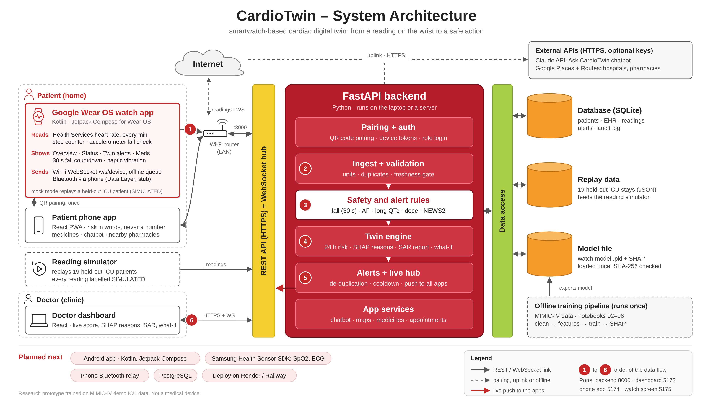
</p>

<p align="center"><sub><a href="assets/architecture/cardiotwin_system_architecture.pdf">Download PDF</a> · The Wear OS box is the designed watch app (🟡 code only). The demo uses the reading simulator. The "Planned next" items are 🔵.</sub></p>

### Data (open and de-identified)

| Dataset | Used for |
|---|---|
| [MIMIC-IV Clinical Demo 2.2](https://physionet.org/content/mimic-iv-demo/2.2/) | EHR, labs, medicines, ICU vitals, outcomes (100 patients) |
| [MIMIC-IV-ECG Demo](https://physionet.org/content/mimic-iv-ecg-demo/0.1/) | ECG features such as QTc |
| [MIMIC-IV Waveform DB 0.1.0](https://physionet.org/content/mimic4wdb/0.1.0/) | Monitor numerics as a stand-in for wearable streams |
| [I-CARE 2.1](https://physionet.org/content/i-care/2.1/) | Cardiac-arrest cohort metadata (exploratory) |

Raw PhysioNet files and the large derived tables are **not** included. `src/build_structured_csv.py` rebuilds them. The repository does include `apps/backend/data/replay/`: small extracts of the 19 held-out test stays from the open-access MIMIC-IV demo, so the demo runs straight after cloning.

### ML pipeline (notebooks 01–08)

**Structure → Merge and clean → Feature engineering (211 features) → EDA → Train (grouped 5-fold CV, Optuna) → SHAP and SAR → Risk engine → What-if simulator**

Models compared: NEWS2, logistic regression, random forest, XGBoost and LightGBM. The selected models are calibrated, given operating points, and saved with a SHA-256 manifest.

### Results on held-out patients

<sub>59 training patients, 15 held-out test patients (4 with an event). 95% bootstrap CIs. Source: `models/model_metadata.json`.</sub>

| Model | AUROC | AUPRC | Events flagged (HIGH) | Median lead time |
|---|:---:|:---:|:---:|:---:|
| NEWS2 baseline (CV) | 0.69 | 0.074 | – | – |
| **Full** · LightGBM, 40 features | **0.80** <sub>[0.70–0.92]</sub> | 0.19 | 3 / 4 | 23 h |
| **Watch** · logistic regression, 46 features | 0.73 <sub>[0.52–0.94]</sub> | 0.19 | 3 / 4 | 23 h |

With only 4 test events, these results show the method works end to end. They do **not** prove clinical performance.

<details>
<summary><b>See model, SHAP and what-if charts</b></summary>

<p>
  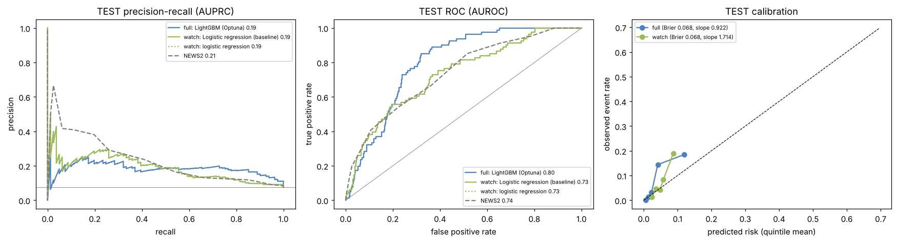
  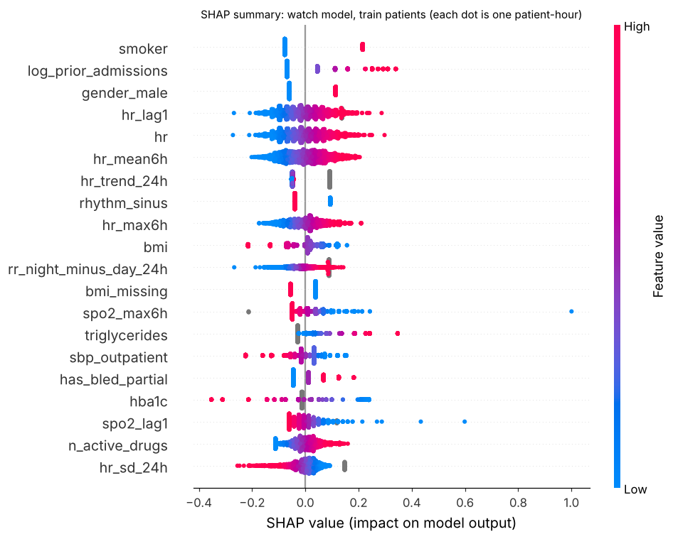
  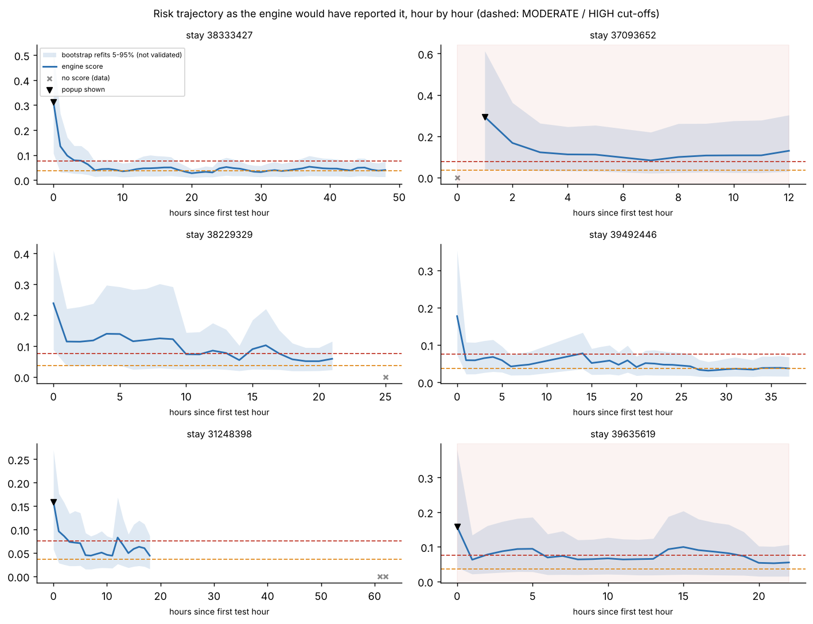
  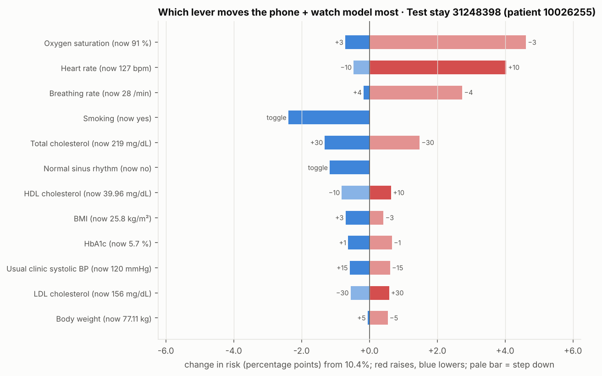
</p>

</details>

## 9. Technical stack

| Layer | Tools |
|---|---|
| **Data & ML** | Python 3.13 · pandas · NumPy · scikit-learn · LightGBM · XGBoost · Optuna · SHAP · Jupyter |
| **Backend** | FastAPI · WebSockets · SQLite |
| **Dashboards** | React · Vite (doctor dashboard, patient app, watch screens) |
| **External APIs** (optional) | Claude API (chatbot) · Google Places and Routes (maps) |
| **Watch app** 🟡 | Kotlin · Wear OS · Health Services (code only, not yet built) |

## 10. Submission files

### a. System Architecture
 [Download the system architecture (PDF)](assets/architecture/cardiotwin_system_architecture.pdf)

### b. Presentation
 [Download the presentation (PDF)](assets/presentation/CardioTwin_AyuRaksha_Presentation.pdf) · [PowerPoint version (PPTX)](assets/presentation/CardioTwin_AyuRaksha_Presentation.pptx)

The presentation was made at the idea stage, so it lists the backend and apps as "planned". They have since been built, except the Wear OS app.

### c. Demo Video
 **YouTube (unlisted, 15–20 min):** `ADD_YOUTUBE_LINK_HERE`

## 11. Run it locally

The demo has four parts: one **backend** and three **web apps** (doctor dashboard, patient app and watch screens). Each runs in its own terminal window. The steps below are for Windows PowerShell. On macOS or Linux, use `python3` instead of `py` and `source .venv/bin/activate` instead of `.\.venv\Scripts\Activate.ps1`.

### Step 1 · Install the tools (once)

| Tool | Version | Check it works |
|---|---|---|
| [Python](https://www.python.org/downloads/) | 3.12 or 3.13 | `py --version` |
| [Node.js](https://nodejs.org/) | LTS (20 or newer) | `node --version` |
| [Git](https://git-scm.com/downloads) | any | `git --version` |

### Step 2 · Download the project

```powershell
git clone https://github.com/tjain2004/CardioTwin-AayuRaksha.git
cd CardioTwin-AayuRaksha
```

### Step 3 · Start the backend (terminal 1)

```powershell
cd apps\backend
py -3.13 -m venv .venv          # or py -3.12
.\.venv\Scripts\Activate.ps1
pip install -r requirements.txt
python -m cardiotwin_backend --host 0.0.0.0
```

- If PowerShell blocks `Activate.ps1`, run `Set-ExecutionPolicy -Scope Process Bypass` and try again.
- The first install takes a few minutes because it includes the ML libraries.
- **Keep this window open.** The backend runs at <http://127.0.0.1:8000>.

### Step 4 · Start the doctor dashboard (terminal 2)

Open a new terminal in the project folder:

```powershell
cd apps\doctor_dashboard
npm ci
npm run dev
```

Open <http://localhost:5173> and sign in as **`dr.demo`** with password **`demo1234`**.

### Step 5 · Start the patient app (terminal 3)

```powershell
cd apps\patient_phone_app
npm ci
npm run dev
```

Open <http://localhost:5174> and sign in as **`p37093652`** with password **`demo1234`**. For a phone-sized view, press `F12` and turn on the device toolbar.

### Step 6 · Start the watch screens (terminal 4)

```powershell
cd apps\watch_ui_web
npm ci
npm run dev
```

Open <http://localhost:5175/?patient=stay-37093652> and sign in as **`dr.demo`** with password **`demo1234`**.

### Step 7 · Run the demo

1. In the doctor dashboard, pick patient **`stay-37093652`**.
2. Press **Start virtual watch**. It replays that ICU patient's recorded vitals as watch readings, labelled SIMULATED.
3. Watch the risk, the SHAP reasons and the SAR report update. The patient app and the watch screens update at the same time.
4. Press **Trigger AF** or **Trigger fall** to see the safety rules and the emergency screens.
5. Stop each part with `Ctrl + C` in its terminal.

### Optional extras

- **AI chatbot and maps:** before Step 3, set these keys in terminal 1. Without them, the app uses the offline assistant and a Google Maps search link.
  ```powershell
  $env:ANTHROPIC_API_KEY = "your-key"
  $env:CARDIOTWIN_GOOGLE_MAPS_SERVER_KEY = "your-key"
  $env:CARDIOTWIN_GOOGLE_MAPS_BROWSER_KEY = "your-key"
  ```
- **Tests:** with the backend's virtual environment active, run `python -m pytest tests -q` inside `apps/backend`, `risk_engine` and `what_if_simulator`.
- **Rebuild the data and models:** download the four PhysioNet datasets into `data/raw/`, run `python src/build_structured_csv.py`, then the notebooks in `notebooks/` from 02 to 08, then `python apps/backend/tools/build_replay_data.py --project .`.

<details>
<summary><b>Common problems</b></summary>

| Problem | Fix |
|---|---|
| `Port 5173 (or 5174, 5175) is already in use` | Another copy is still running. Close that terminal or press `Ctrl + C` in it. |
| The dashboard shows no patients or does not update | Check that terminal 1 (the backend) is still running and shows no errors. |
| `py` is not recognised | Reinstall Python and tick **Add python.exe to PATH**, or use `python` instead of `py -3.13`. |
| `npm ci` fails | Delete the `node_modules` folder in that app and run `npm ci` again. |

</details>

<details>
<summary><b>Repository structure</b></summary>

```
apps/               backend · doctor_dashboard · patient_phone_app · watch_ui_web · wear_os_watch
notebooks/          01–08: data → cleaning → features → EDA → training → SHAP → risk engine → what-if
src/                data building and preprocessing scripts
risk_engine/        inference module used by the backend
what_if_simulator/  what-if engine and tests
models/             trained models, calibration, schema, metadata
charts/             EDA, model, SHAP, risk-engine and what-if charts
assets/             README images, logos, screenshots, architecture PDF, presentation
```

</details>

## 12. Responsible AI and limitations

- **Not a medical device.** This is a research prototype without clinical validation. Do not use it for diagnosis or treatment.
- **Small ICU cohort.** It was trained on 59 patients and tested on 15, so results won't transfer directly to outpatients or wearables.
- **It predicts deterioration, not CAD.** The CAD view is a risk-factor profile, not a diagnosis.
- **No real wearable data.** The "watch" readings are replayed ICU data, and some signals are synthetic.
- **Draft safety rules.** AF, QTc, dose and fall thresholds need clinical review.
- **Nothing is dispatched.** The app never contacts emergency services, and only the user can place a call.
- **The chatbot doesn't diagnose.** It explains existing results and never invents scores or changes medicines.
- **Privacy.** Only open, de-identified data is used, keys stay on the server and decisions are audit-logged. Production use would need encryption, consent management and DPDP Act compliance.

## 13. License

The code is released under the **[MIT License](LICENSE)**. The datasets keep their own PhysioNet licences and must be downloaded from [PhysioNet](https://physionet.org/).

**Acknowledgements:** Happiest Health and Unstop for the challenge; PhysioNet and MIT-LCP for MIMIC-IV; the I-CARE consortium.

<p align="center"><sub>❤️ CardioTwin · Team AyuRaksha · research prototype, not medical advice</sub></p>
